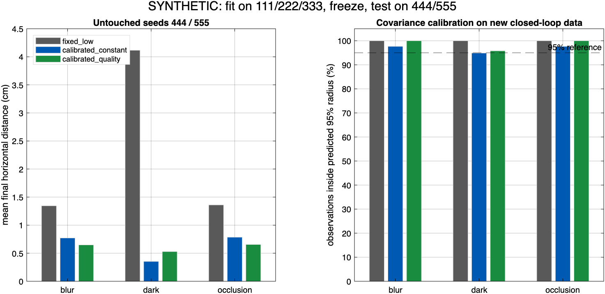

# ArUco-Guided Drone Landing Simulation

A MATLAB simulation of a quadrotor landing on an ArUco marker. I tested how much the state estimator should trust marker detections when the camera image is blurred, dark or partly obstructed.

## Results

Calibrating a single noise level for marker positions reduced mean horizontal landing error from **2.27 cm to 0.64 cm** in simulation. Adjusting the noise level for each image brought the mean to 0.61 cm and performed worse than the calibrated constant in low light.

| Image condition | Original fixed (cm) | Calibrated constant (cm) | Feature-based (cm) |
| --- | ---: | ---: | ---: |
| Blur | 1.34 | 0.77 | 0.65 |
| Low light | 4.12 | 0.35 | 0.53 |
| Partial occlusion | 1.36 | 0.78 | 0.65 |
| **All conditions** | **2.27** | **0.64** | **0.61** |

Each condition averages two flights per method. All 18 flights used synthetic camera images and an ideal ground plane. The evaluation used two random seeds held out from calibration, with the same image degradation settings. Hardware performance remains untested.



[Per-flight results (CSV)](results/comparison.csv) · Example frames [blur](results/blur_example.png), [low light](results/dark_example.png), [partial occlusion](results/occlusion_example.png)

## How it works

MATLAB renders frames from a downward-facing camera, detects the marker and computes Farnebäck optical flow between frames. The state estimator combines those observations with delayed, noisy inertial and height measurements. The controller uses the estimated state to guide the descent.

Python fits the observation noise using position errors from 994 accepted detections on seeds 111, 222 and 333. The flight comparison uses the frozen calibration on seeds 444 and 555. The feature-based model uses measurements such as marker area, exposure and sharpness to adjust its noise estimate.

## Run the simulation

Run from the repository root with MATLAB R2026a, Computer Vision Toolbox, Image Processing Toolbox, and Python 3 with NumPy.

```sh
python3 -m venv .venv
. .venv/bin/activate
python -m pip install numpy
matlab -batch "run_calibrated_images"
python analyse.py
matlab -batch "plot_results"
```

Start with the [MATLAB runner](run_calibrated_images.m), [Python analysis](analyse.py) or [calibration script](fit_calibration.py). The runner uses the included calibration and writes per-flight logs to `results/`. To refit the model, run `python fit_calibration.py` in a separate copy before simulating.

This is a personal project developed with AI assistance.
